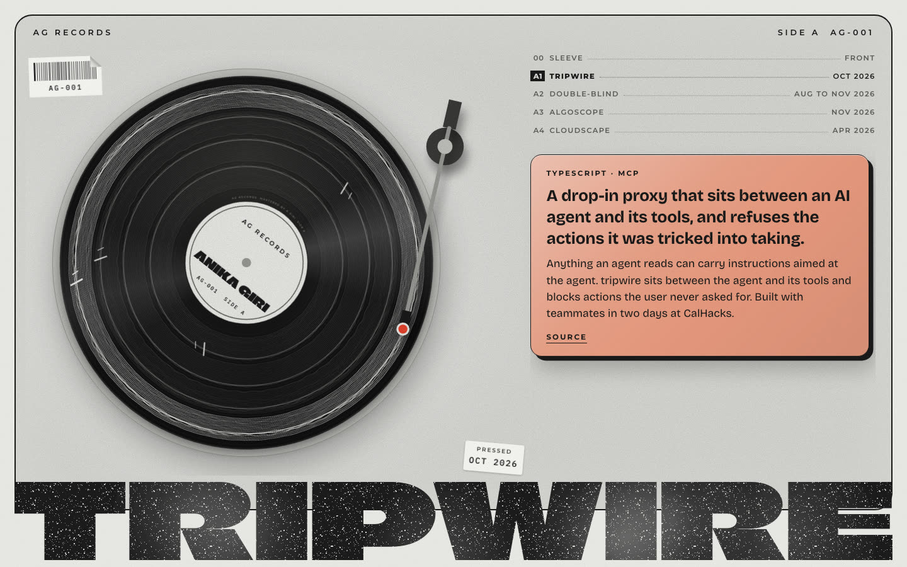
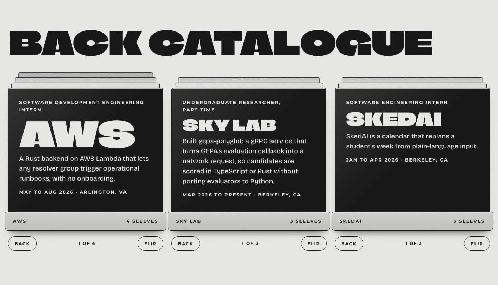

# AG Records

**[anikag35.github.io/ag-records](https://anikag35.github.io/ag-records/)**

Anika Giri's portfolio, set as a record label. The record is the interface: each project is a band on a vinyl, and the tonearm is the navigation.

## How it works

**The turntable.** The record is drawn in canvas at device pixel ratio. Each release is one band, separated by gaps like the tracks on an LP. Scroll moves the needle inward, and the band under it becomes the active release. Its name fills the bottom of the page and its notes appear beside the record. Clicking a band, using the tracklist, or the arrow keys drops the needle too.

**Real commit history.** The groove wobble inside each band follows that repository's actual commit activity, oldest at the outer edge. `npm run commits` pulls it from GitHub and counts only Anika's own commits. The result is committed, so builds need no network or token and stay reproducible.

**The back catalogue.** Work experience is three record-store crates. Each crate is a stack of sleeves you flip through: the job first, then one sleeve per thing done there.

## Fallbacks

- **Reduced motion or no JavaScript:** the turntable is replaced by a plain, fully readable tracklist, and the crates become a list.
- **Narrow screens:** the record sits on top with no scroll pinning, bands are tapped, and the crates become a sideways-scrolling row.
- **Keyboard:** everything is reachable, focus is always visible, and a skip link jumps past the turntable.
- **Background tabs:** the record draws on first paint, and the canvas pauses when offscreen.

## Stack

Astro with static output, canvas 2D for the record, no UI framework. Deployed to GitHub Pages by the official Astro action on every push to `main`.

## Development

Node is pinned in `.nvmrc`. Install that version with nvm, then:

| Command | Does |
| --- | --- |
| `npm run dev` | Dev server on port 4321. Astro runs it in the background. |
| `npm run build` | Static site in `dist/`. |
| `npm run commits` | Refresh commit waveforms from GitHub. Needs `gh` auth. |
| `npm run check:dashes` | Fails if an em or en dash appears in site copy. |
| `node scripts/lab-capture.mjs` | Turntable checks and screenshots at 800x600, 1440x900 and mobile. |
| `node scripts/crates-capture.mjs` | Crate checks, including reduced motion and no JavaScript. |

The capture scripts need the dev server running. All site copy lives in `src/data/catalogue.ts`.
